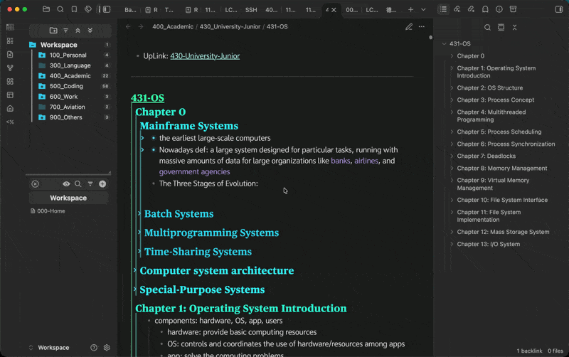

# Recursive Fold

Expand or collapse an entire branch in [Obsidian](https://obsidian.md) with one click, instead of
one level at a time.

Obsidian's fold arrows toggle a single level. Reaching a heading five levels deep takes five
clicks, and collapsing a section keeps every level inside it as it was, so tidying up means closing
each one separately. Recursive Fold adds a modifier-click: `Cmd`-click (macOS) or `Ctrl`-click
(Windows, Linux) any fold arrow, and the item opens or closes together with everything nested
under it.

## Where it works

| Location | What folds |
| --- | --- |
| Notes, in Reading view, Live Preview and Source mode | Headings and list items |
| File explorer | Folders |
| Bookmarks | Bookmark groups |
| Tags | Nested tags |
| Outline | Headings |

## Usage

| Action | Result |
| --- | --- |
| Modifier-click a collapsed arrow | Expands the item and every level beneath it. |
| Modifier-click an expanded arrow | Collapses the item and every level beneath it. |
| **Toggle fold recursively** command | The same, for the section at the cursor, or at the top of the page in Reading view. Bind it under **Settings → Hotkeys**. |

Plain clicks keep Obsidian's single-level behavior. Folds in notes are saved like any other fold
and carry over between Reading view and the editor.

**Tip:** to open just the next level, modifier-click to collapse the whole branch, then plain-click
the same arrow. Its children appear with everything beneath them still folded.

## Settings

| Setting | Default | Options |
| --- | --- | --- |
| Modifier key | `Cmd` on macOS, `Ctrl` elsewhere | `Option`/`Alt`, `Shift`, or off |

## Installation

### From Obsidian (recommended)

**Settings → Community plugins → Browse**, search for *Recursive Fold*, then install and enable it.
Or open [the plugin page](https://obsidian.md/plugins?id=recursive-fold) and click
**Add to Obsidian**.

### Manually

Download `main.js` and `manifest.json` from the
[latest release](https://github.com/rogerfan48/recursive-fold/releases/latest) and place them in
`<your vault>/.obsidian/plugins/recursive-fold/`, then reload Obsidian and enable the plugin.

## Limitations

- Embedded notes, hover previews and Canvas cards are not supported.
- Mobile devices have no modifier keys; use the command instead.
- The plugin builds on parts of Obsidian outside its public API. If an update changes them,
  modifier-clicks fall back to a single-level toggle until the plugin is updated.

## Related

Also by me: [Better Heading Hierarchy](https://github.com/rogerfan48/better-heading-hierarchy),
which draws guide lines that make the nesting of headings visible at a glance.

## Contributing

Bug reports and pull requests are welcome; see [CONTRIBUTING.md](CONTRIBUTING.md).

## License

[MIT](LICENSE) © rogerfan48
